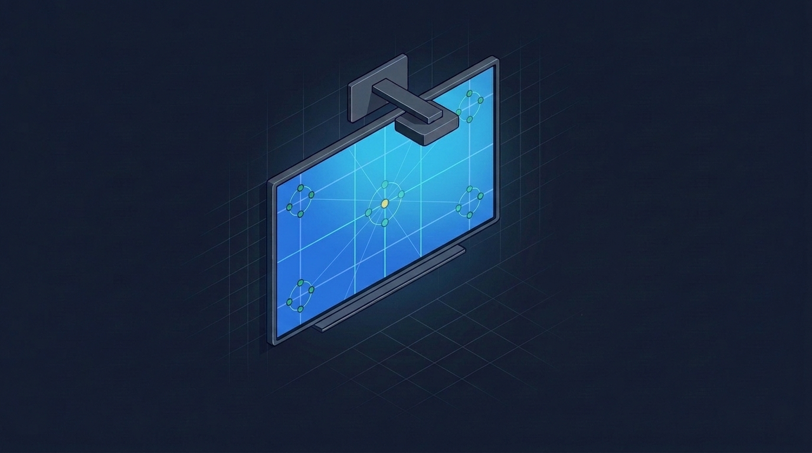
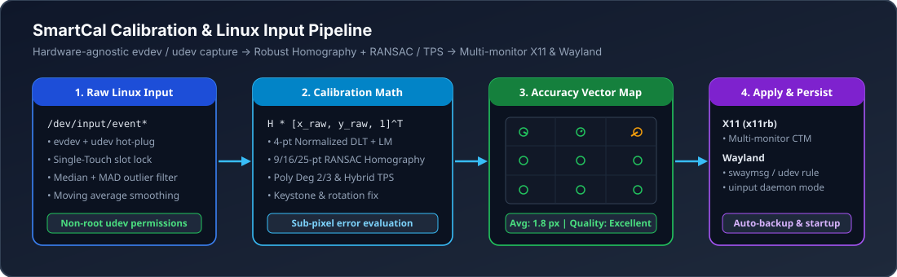

<p align="center">
  
</p>

<div dir="rtl">

# SmartCal — سامانه حرفه‌ای کالیبراسیون تخته هوشمند و پروژکتور تعاملی برای لینوکس

**[English](README.md) | فارسی**

**SmartCal** یک نرم‌افزار آزاد، ماژولار و آماده استفاده در مدارس و کلاس‌های درس برای دسکتاپ **لینوکس** است که با زبان **Rust** پیاده‌سازی شده تا اختلاف مختصات بین **لمس تخته هوشمند / قلم نوری** و **تصویر پروژکتور یا نمایشگر** را در محیط‌های **X11** و **Wayland** با دقت زیرپیکسل محاسبه و اصلاح کند.

---

## نمای کلی معماری و جریان کالیبراسیون

<p align="center">
  
</p>

---

## چرا SmartCal؟

در بسیاری از مدارس، وقتی رایانه لینوکسی به ویدئو پروژکتور و تخته هوشمند USB متصل می‌شود، محل لمس روی تخته با مکان‌نمای صفحه هم‌راستا نیست (به‌دلیل جابه‌جایی، مقیاس، چرخش ۹۰/۱۸۰/۲۷۰ درجه، اعوجاج پرسپکتیو/کیستون یا اشتباه افتادن لمس روی مانیتور لپ‌تاپ به‌جای پروژکتور).

**SmartCal** بدون وابستگی به برند خاصی از تخته هوشمند، مستقیماً از APIهای استاندارد لینوکس استفاده می‌کند و با یک کلیک یا ویزارد گام‌به‌گام مشکل را حل می‌کند.

---

## امکانات کلیدی

- **کالیبره سریع تک‌کلیکی (Quick Calibrate)**:
  - دکمه بزرگ و برجسته **«کالیبره سریع (تمام‌صفحه)»** در گوشه بالای برنامه: با یک کلیک بلافاصله به حالت تمام‌صفحه می‌رود، نقاط هدف (`●`) را دونه به دونه نمایش می‌دهد، با لمس هر نقطه نویز را حذف کرده و کالیبراسیون را محاسبه می‌کند.
- **ویزارد حرفه‌ای ۳ مرحله‌ای و حالت پروژکتور (Projector Mode)**:
  - **مرحله ۱**: نقشه تعاملی و قابل کلیک نمایشگرها (تشخیص خودکار پروژکتور، رزولوشن، نرخ تازه‌سازی و چیدمان چندمانیتوره).
  - **مرحله ۲**: انتخاب دستگاه ورودی (`/dev/input/event*`، Vendor/Product ID، تشخیص خودکار Single-Touch / Multi-Touch) به‌همراه **تشخیص زنده سیگنال لمس** برای شناسایی مطمئن تخته در کلاس.
  - **مرحله ۳**: انتخاب حالت **4 نقطه‌ای**، **9 نقطه‌ای (پیش‌فرض)**، **16 نقطه‌ای**، **25 نقطه‌ای** یا **کالیبراسیون پیشرفته** با پیش‌نمایش زنده شبکه نقاط.
  - **حالت پروژکتور**: تمام‌صفحه واقعی روی نمایشگر انتخاب‌شده، مخفی‌سازی پنل‌ها و نوار وظیفه، جلوگیری موقت از Screen Saver و Sleep (`systemd-inhibit`، DBus و X11 DPMS) و بازگرداندن خودکار تنظیمات پس از پایان یا فشردن `ESC`.
- **موتور ریاضی دقیق (`smartcal-math`)**:
  - **4 نقطه**: تبدیل تصویری دقیق (**Projective Homography** با نرمال‌سازی Hartley، DLT و بهینه‌سازی غیرخطی Levenberg-Marquardt).
  - **9 / 16 / 25 نقطه**: هموگرافی مقاوم با الگوریتم **RANSAC** جهت حذف خودکار لمس‌های خطادار.
  - **مدل‌های غیرخطی پیشرفته**: چندجمله‌ای درجه ۲ و ۳ و مدل ترکیبی **Homography + Thin-Plate Spline (TPS)** برای جبران انحنای لنز پروژکتور یا شیشه تخته.
  - اصلاح کامل Offset، Scaling، معکوس‌شدن محور، Rotation، Perspective، Keystone و انحراف‌های غیرخطی.
- **فیلتر نویز لمس و پایداری در کلاس**:
  - قفل تک‌لمس (`SingleTouchTracker`) جهت جلوگیری از تداخل کف دست یا انگشت دوم در تخته‌های Multi-Touch.
  - حذف نمونه‌های اولیه، فیلتر میانه، تشخیص Outlier با MAD، میانگین متحرک، حداقل زمان لمس و حداکثر انحراف قابل تنظیم.
  - پشتیبانی از قطع/وصل USB بدون کرش و مانیتورینگ Hot-plug از طریق `NETLINK_KOBJECT_UEVENT`.
- **ارزیابی خطا، نقشه برداری و حالت آزمایش (Test Mode)**:
  - نمایش خطای پیکسلی تک‌تک نقاط، میانگین، بیشینه، RMS و کیفیت (`Excellent` / `Good` / `Acceptable` / `Poor`).
  - **نقشه مکانی خطای کالیبراسیون** با بزرگ‌نمایی ۱۵ برابری بردار خطا.
  - **حالت Test Mode**: شبکه تعاملی با رسم مسیر لمس و نمایش زنده مختصات `Raw`، `Screen` و `Error (px)`.
- **سازگار با X11 و Wayland بدون نیاز به اجرای GUI با `root`**:
  - اعمال مستقیم ماتریس `Coordinate Transformation Matrix` در X11 (`x11rb` XInput2 / `xinput`) با جداسازی دقیق مانیتورها.
  - پشتیبانی از Wayland از طریق IPC کمپوزیتور (`swaymsg` / `gsettings`)، قوانین `udev` (`LIBINPUT_CALIBRATION_MATRIX`) و سرویس اختیاری `/dev/uinput` (`smartcal --daemon`) برای دقت کامل هموگرافی/چندجمله‌ای.
  - پروفایل‌های JSON، پشتیبان‌گیری خودکار پیش از اعمال، بازگردانی نسخه قبلی (`Restore Previous Calibration`)، بازنشانی (`Reset Calibration`)، اجرای خودکار در استارتاپ و ابزار کامل **Diagnostics** با خروجی `calibration-diagnostics.txt`.
- **رابط کاربری دوزبانه (فارسی و English) + تم روشن و تیره**.

---

## معماری پروژه

| ماژول | مسئولیت |
| :--- | :--- |
| `crates/smartcal-core` | مدل‌های داده، خطاها، ذخیره/پشتیبان پروفایل‌های JSON، تنظیمات و لاگ چرخشی |
| `crates/smartcal-math` | محاسبات Homography، RANSAC، LM، Polynomial، TPS، ماتریس چندمانیتوره و فیلتر نویز |
| `crates/smartcal-linux` | ارتباط با `evdev`، `udev`، `libinput`، `x11rb` (XRandR/XInput2/DPMS)، `wayland-client` و `uinput` |
| `crates/smartcal-i18n` | ترجمه فارسی و انگلیسی و مدیریت BiDi (`unicode-bidi`) سازگار با `harfrust` |
| `crates/smartcal-gui` | رابط گرافیکی `eframe`/`egui`، ویزارد، کالیبراسیون تمام‌صفحه، Test Mode و Diagnostics |
| `crates/smartcal-cli` | باینری `smartcal` و دستورات کامل خط فرمان |

---

## نصب در لینوکس

### روش ۰ (سریع‌ترین): دانلود نسخه آماده بدون نیاز به کامپایل از Releases

برای تست فوری بدون نصب Rust و بدون کامپایل سورس، از بخش [**GitHub Releases**](https://github.com/ShayanTxT/smartcal/releases/latest) فایل متناسب با توزیع خود را دانلود کنید:

- **بسته آماده Ubuntu / Debian / Linux Mint (`.deb`)**:
  ```bash
  sudo apt install ./smartcal_*_amd64.deb
  ```
- **فایل اجرای مستقیم روی همه توزیع‌ها (`AppImage`)**:
  ```bash
  chmod +x SmartCal-*-x86_64.AppImage
  ./SmartCal-*-x86_64.AppImage
  ```
- **بسته فشرده پرتابل (`.tar.gz`)**:
  ```bash
  tar -xzf smartcal-*-linux-x86_64.tar.gz
  cd smartcal-*-linux-x86_64
  ./install-release.sh   # یا اجرای مستقیم: ./smartcal
  ```

---

### روش ۱: کامپایل و نصب خودکار از سورس (`install.sh`)
اسکریپت زیر به‌صورت خودکار وابستگی‌ها را روی اوبونتو/دبیان/مینت، فدورا، آرچ یا اوپن‌سوزه نصب کرده، نسخه Release را می‌سازد و قانون دسترسی `udev` و آیکون دسکتاپ را نصب می‌کند:

```bash
chmod +x install.sh uninstall.sh packaging/*.sh
./install.sh
```

برای حذف کامل:

```bash
./uninstall.sh
```

### روش ۲: ساخت بسته دبیان (`.deb`) برای Ubuntu / Debian / Mint

```bash
./packaging/build-deb.sh
sudo dpkg -i dist/smartcal_1.0.0_amd64.deb
```

### روش ۳: ساخت `AppImage`

```bash
./packaging/build-appimage.sh
```

### دسترسی غیر-`root` برای خواندن تخته هوشمند
در لینوکس برای اینکه معلم یا کاربر عادی بدون `sudo` بتواند کالیبراسیون را انجام دهد:

```bash
sudo smartcal --install-udev-rule
sudo usermod -aG input "$USER"
```
*(پس از افزودن به گروه `input` یک‌بار Logout/Login کنید.)*

---

## دستورات خط فرمان (CLI)

```bash
smartcal                                 # اجرای رابط گرافیکی
smartcal --list-displays                 # نمایش فهرست نمایشگرها و پروژکتورها
smartcal --list-devices                  # نمایش دستگاه‌های لمسی و مسیر /dev/input/eventX
smartcal --calibrate --no-gui            # کالیبراسیون متنی بدون GUI
smartcal --apply classroom-projector     # اعمال پروفایل ذخیره‌شده
smartcal --apply-startup                 # اعمال خودکار پروفایل‌های فعال در استارتاپ
smartcal --reset                         # بازنشانی ماتریس دستگاه به حالت پیش‌فرض
smartcal --restore                       # بازیابی آخرین پروفایل پشتیبان‌گیری‌شده
smartcal --test --no-gui                 # آزمایش زنده مختصات خام و کالیبره‌شده در ترمینال
smartcal --diagnostics --export calibration-diagnostics.txt
smartcal --daemon classroom-projector    # اجرای سرویس uinput برای مدل‌های غیرخطی/پرسپکتیو
```

---

## مجوز انتشار

این پروژه تحت دو مجوز **MIT** یا **Apache-2.0** ([LICENSE-MIT](LICENSE-MIT) / [LICENSE-APACHE](LICENSE-APACHE)) منتشر شده است.

</div>
