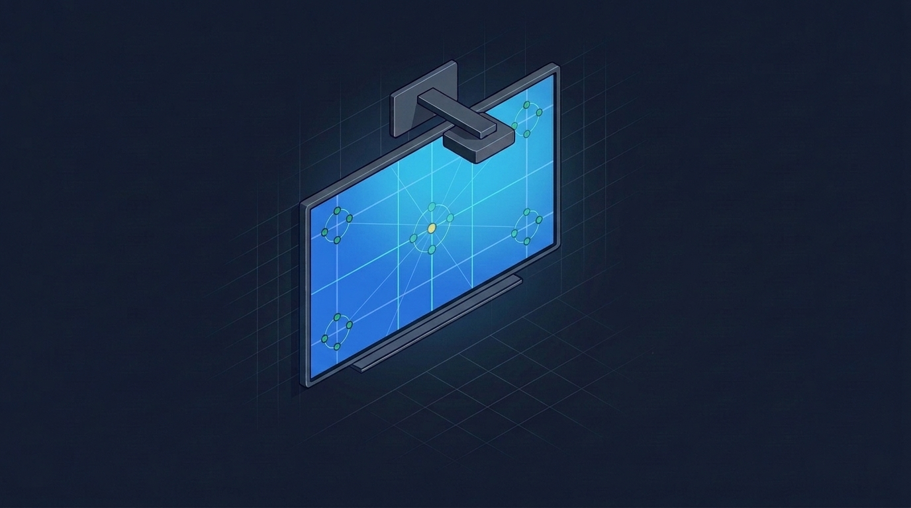
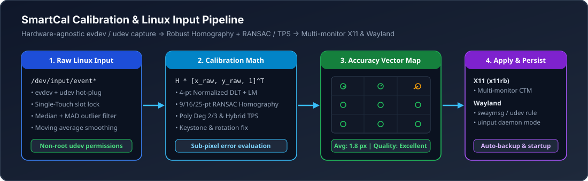

<p align="center">
  
</p>

# SmartCal — Smart Board & Interactive Projector Calibration Suite for Linux

**English | [فارسی](README.fa.md)**

[](https://github.com/ShayanTxT/smartcal/actions/workflows/ci.yml)
[](LICENSE-MIT)
-0F172A?logo=linux)


**SmartCal** is a hardware-agnostic, classroom-ready Linux desktop & CLI application written in **Rust** for calibrating Smart Boards, Interactive Whiteboards, Touch Displays, Stylus Panels, and Ceiling/Wall Interactive Projectors across **X11** and **Wayland**.

---

## Calibration Pipeline Overview

<p align="center">
  
</p>

---

## Key Features

- **1-Click Quick Calibrate & Guided 3-Step Wizard**:
  - **Quick Calibrate (Fullscreen)** button in the top bar and dashboard hero launches instant fullscreen point-by-point calibration on your selected display in one click.
  - **3-Step Guided Wizard** for multi-monitor setups: clickable monitor layout diagram (Step 1), live `evdev` touch signal probe to verify the exact board controller (Step 2), and calibration grid preview (Step 3: 4, 9 default, 16, 25, or Advanced).
- **Linux-Native Input & Display Stack**:
  - Reads raw touch/stylus coordinates directly from `/dev/input/event*` (`evdev`) with `/sys/class/input` + `/run/udev/data` metadata and `AF_NETLINK` USB hot-plug detection.
  - Native **X11** integration via `x11rb` (XRandR display enumeration, XInput2 `Coordinate Transformation Matrix`, DPMS/ScreenSaver state capture & restore).
  - Native **Wayland** support via `wayland-client` (`wl_output`, `xdg_output_manager_v1`), compositor IPC (`Sway`, `Mutter`, `KWin`, `Hyprland`), `udev` `LIBINPUT_CALIBRATION_MATRIX` rule generation, and an optional userspace `/dev/uinput` calibration daemon (`smartcal --daemon`) for full projective/non-linear correction.
  - Detects **Single Touch** vs **Multi Touch** hardware and locks onto a single primary contact during calibration so extra fingers or palm touches never corrupt calibration.
- **High-Precision Calibration Math**:
  - **4-Point**: Exact Projective Transformation (Normalized DLT Homography + Levenberg-Marquardt refinement).
  - **9 / 16 / 25-Point**: Robust Homography + **RANSAC** outlier rejection + LM pixel-reprojection refinement.
  - **Advanced Calibration**: Degree-2 / Degree-3 Bivariate Polynomial regression and **Hybrid Homography + Thin-Plate Spline (TPS)** for non-linear lens/glass distortion.
  - Corrects offset, scaling, axis inversion, arbitrary rotation, perspective/keystone distortion, and non-linear deviation.
- **Touch Noise Filtering Pipeline**:
  - Discards initial landing transient samples, enforces minimum touch duration, runs component-wise **Median Filter** + **MAD Outlier Detection** + **Moving Average** + duplicate/spread validation.
- **Projector Mode, Accuracy Map & Test Mode**:
  - **Projector Mode**: true borderless fullscreen strictly on the selected monitor, inhibits sleep/screensaver (`systemd-inhibit` + DBus `ScreenSaver` + X11 DPMS), and restores system settings automatically on completion or `ESC`.
  - **Spatial Accuracy Vector Map**: visualizes residual pixel error vectors (×15 magnified) across the entire display alongside per-point error metrics and quality grading (`Excellent` / `Good` / `Acceptable` / `Poor`).
  - **Test Mode**: interactive precision grid (4×3, 6×4, 10×6) with live `Raw`, `Screen`, and `Error (px)` readouts and smooth touch trail drawing.
- **Bilingual UI & Classroom Polish**:
  - Full **English** and **فارسی (Persian)** UI with native OpenType/HarfBuzz shaping (`harfrust` + `unicode-bidi`), **Light Mode**, **Dark Mode**, and **High Contrast** canvas mode.
  - JSON profiles (`~/.config/smartcal/profiles/*.json`), automatic pre-apply backups, `Reset Calibration`, `Restore Previous Calibration`, startup auto-apply (`~/.config/autostart/smartcal-autostart.desktop`), and full Diagnostics export (`calibration-diagnostics.txt`).

---

## Workspace Architecture

| Crate | Responsibility |
| :--- | :--- |
| `crates/smartcal-core` | Domain types, errors, JSON profile/backup store, XDG autostart, rolling logs |
| `crates/smartcal-math` | Hartley DLT homography, LM refinement, RANSAC, polynomials, TPS, CTM composition & noise filters |
| `crates/smartcal-linux` | `evdev`, sysfs/udev, `libinput` probe, `x11rb` XRandR/XInput2/DPMS, `wayland-client`, `uinput` daemon |
| `crates/smartcal-i18n` | English & Persian dictionary, `unicode-bidi` visual run ordering & logical wrapping |
| `crates/smartcal-gui` | `eframe`/`egui` desktop UI, vector icons, wizard stepper, fullscreen canvas & accuracy map |
| `crates/smartcal-cli` | `smartcal` binary entry point and CLI automation flags |

---

## Installation on Linux

```bash
chmod +x install.sh uninstall.sh packaging/*.sh
./install.sh
```

Or build a `.deb` package (Debian / Ubuntu / Linux Mint):

```bash
./packaging/build-deb.sh
sudo dpkg -i dist/smartcal_1.0.0_amd64.deb
```

Or stage/build an `AppImage`:

```bash
./packaging/build-appimage.sh
```

### Non-Root Permissions (`udev`)
SmartCal never needs the GUI to run as `root`. Install the included udev rule and add classroom users to the `input` group:

```bash
sudo smartcal --install-udev-rule
sudo usermod -aG input "$USER"
```

---

## CLI Usage

```bash
smartcal                          # Launch Desktop GUI
smartcal --list-displays          # List connected monitors/projectors
smartcal --list-devices           # List touchscreens, styluses, mice & /dev/input/eventX
smartcal --calibrate --no-gui     # Headless terminal evdev calibration
smartcal --apply classroom-projector
smartcal --apply-startup          # Apply all profiles marked auto_apply=true
smartcal --reset                  # Reset device transformation matrix to identity
smartcal --restore                # Restore most recent backed-up calibration
smartcal --test --no-gui          # Live evdev coordinate readout in terminal
smartcal --diagnostics --export calibration-diagnostics.txt
smartcal --daemon classroom-projector  # Full projective/polynomial uinput daemon
```

---

## License

Dual-licensed under [MIT](LICENSE-MIT) OR [Apache-2.0](LICENSE-APACHE).
